<div align="center">


# Ἀλέξανδρος

**Iron Man has Jarvis. You have Alexander.**

A private, calm command center for one person — plan the day, keep your habits honest,<br/>
time your deep work, chase a few great missions, and never forget how much time is left.

<br/>


<sub>Black. Quiet. One crystal-blue accent. Works offline. Yours alone.</sub>

</div>

<br/>

<table>
<tr>
<td width="33%" valign="top">

### ⚔️ &nbsp;Act
Today's tasks, daily habits, a focus timer, and a calendar that shows how your days really went.

</td>
<td width="33%" valign="top">

### 🏛️ &nbsp;Aim
Three missions for life, goals with deadlines, plans with dated steps, and ideas you research before you commit.

</td>
<td width="33%" valign="top">

### 🕯️ &nbsp;Reflect
A journal that fits above the keyboard, true stories of courage, and your life counted in weeks.

</td>
</tr>
</table>

---

## Contents

- [The map](#the-map)
- [A day with Alexander](#a-day-with-alexander)
- [Every section](#every-section)
- [How the honest parts work](#how-the-honest-parts-work)
- [Under the hood](#under-the-hood)
- [Sync between phone and laptop](#sync-between-phone-and-laptop)
- [Run it](#run-it)
- [Put it online](#put-it-online)
- [Privacy](#privacy)
- [Project layout](#project-layout)
- [Credits](#credits)

---

## The map

Seventeen sections, in four families. On a phone the four you use most sit in the bottom bar; a glowing crystal orb above it opens all the rest.

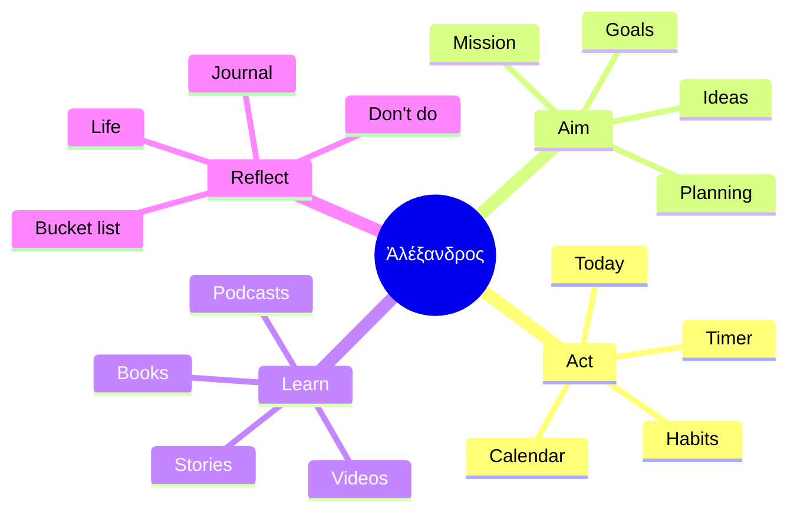

<sub>Plus <b>Settings</b> — name, success line, passcode, sync and backups.</sub>

---

## A day with Alexander

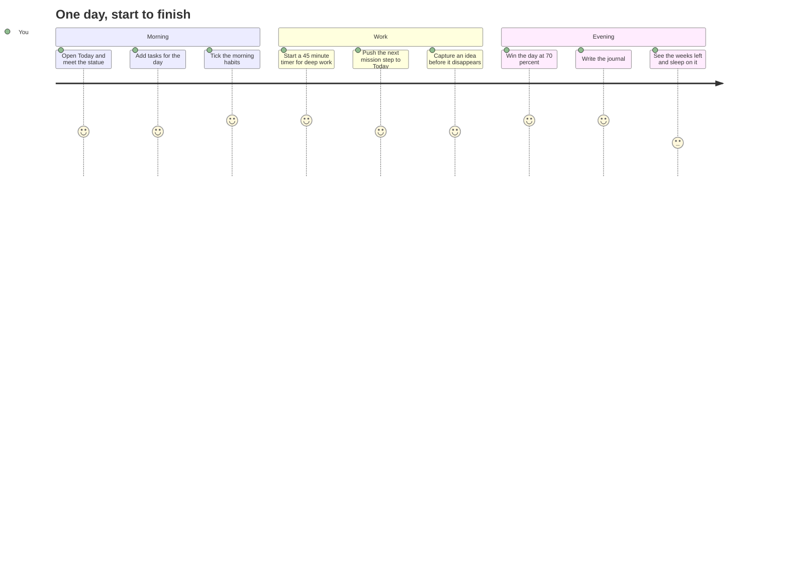

---

## Every section

<table>
<tr><th align="left">Section</th><th align="left">What it is for</th><th align="left">The detail that matters</th></tr>

<tr><td><b>Today</b></td><td>Your tasks, beside a small marble head of Alexander and today's completion %.</td><td>A day is <b>won</b> at 70% (your choice). Switch to Tomorrow to plan ahead. Every task can carry a note.</td></tr>

<tr><td><b>Habits</b></td><td>Things you do every day.</td><td>Only today can be ticked. A day left unticked stays <b>not done</b> — forever. Streaks, best streak, done rate, six months at a glance.</td></tr>

<tr><td><b>Timer</b></td><td>Time a task until a chosen end.</td><td>15 m to 1 h 30 m, or <i>until</i> a clock time. Ends with a soft chime on any page; the countdown shows in the tab title. Shows time per task, per day.</td></tr>

<tr><td><b>Calendar</b></td><td>How your days really went.</td><td>Average, days won, streak and focus time over 7 / 30 / 90 days; scrub the charts with a finger; a six-month heatmap.</td></tr>

<tr><td><b>Mission</b></td><td>At most <b>three</b> missions for life.</td><td>Each has a title, description and icon. Opening one shows its vision first — your images, whole, one below another — then the plan.</td></tr>

<tr><td><b>Goals</b></td><td>Concrete targets with a deadline.</td><td>Days left, a vision, a plan, and <i>Mark achieved</i>.</td></tr>

<tr><td><b>Planning</b></td><td>Plans for anything — a trip, a launch, an exam.</td><td>Status, priority and a <b>Complete by</b> date; dated steps; the next step goes to Today in one tap.</td></tr>

<tr><td><b>Ideas</b></td><td>Catch it, research it, decide.</td><td>Accept or reject — and write down <i>why</i>, so you remember next time.</td></tr>

<tr><td><b>Journal</b></td><td>One page a day.</td><td>Full screen, always above the phone keyboard, saves as you type, shows your streak.</td></tr>

<tr><td><b>Books</b></td><td>Read several at once.</td><td>Page progress per book; covers found automatically; finishing asks <i>what action will you take?</i></td></tr>

<tr><td><b>Videos</b></td><td>A YouTube queue.</td><td>Paste a link — title, thumbnail, length, views and date fill in.</td></tr>

<tr><td><b>Podcasts</b></td><td>Episodes to listen to.</td><td>Paste a link or type a name; add a note.</td></tr>

<tr><td><b>Stories</b></td><td>56 short true stories of courage.</td><td>Eleven of Alexander, then Leonidas, Caesar, Shivaji, Lakshmibai, Shackleton, Gandhi, Mandela and more — every picture a real depiction, every story sourced. Add your own.</td></tr>

<tr><td><b>Bucket list</b></td><td>The life outside work.</td><td>Places, adventures, moments — with a photo — marked <i>lived</i>.</td></tr>

<tr><td><b>Don't do</b></td><td>Lines you don't cross.</td><td>A short list you read, not tick.</td></tr>

<tr><td><b>Life</b></td><td>Your time, plainly.</td><td>Days, weeks or months left, % lived, what's left of today, this week, month and year — and your whole life drawn day by day, week by week or month by month.</td></tr>
</table>

> [!TIP]
> **Quick add speaks plain English.** Type `Gym !high tomorrow`, `Call mom on friday` or `Read +3d` — the priority and the day are understood, the rest becomes the title.

> [!NOTE]
> Lists can be reordered: drag the ⋮⋮ handle with a mouse, press and hold on a phone, or focus it and use <kbd>Enter</kbd> and the arrow keys.

---

## How the honest parts work

### A habit's day

There is no going back to tick yesterday. That is the point.

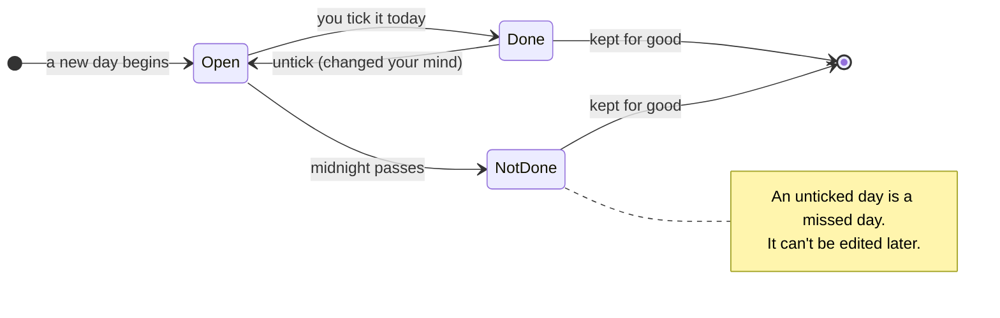

### An idea's life

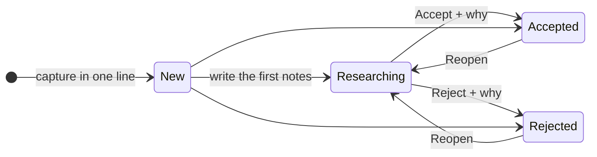

### A timer session

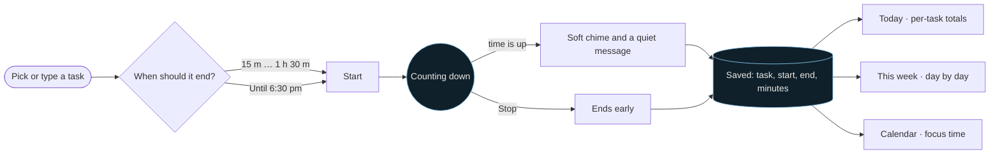

### Your life, counted

The Life section counts weeks, not years — a week is small enough to feel. An example: someone aged 25 with a 72-year expectancy.

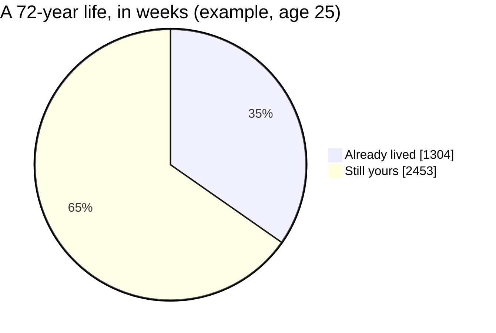

---

## Under the hood

Every device keeps its own full copy of your data, so the app opens instantly and works on a plane. The server only keeps devices in step.

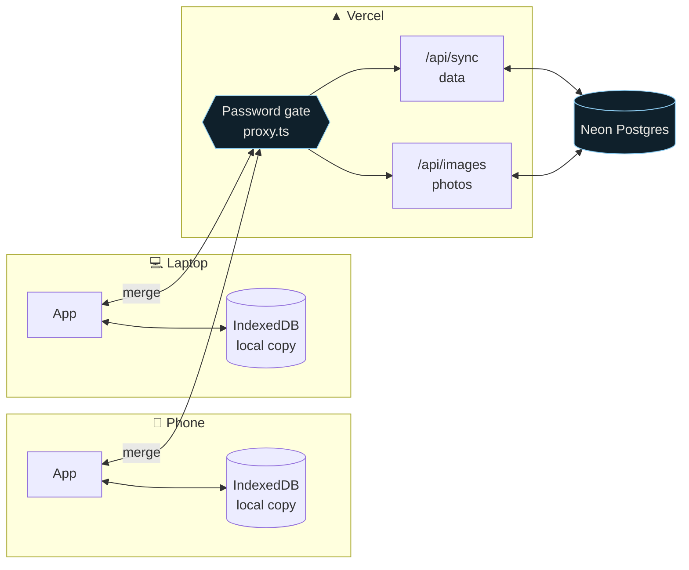

| Layer | What it uses | Why |
| :-- | :-- | :-- |
| Interface | Next.js 16 App Router · React 19 · Tailwind CSS 4 | Fast, one codebase for phone and desktop |
| State | Zustand, saved to IndexedDB in small batches | Instant on every tap; typing never stalls |
| Motion | CSS keyframes · View Transitions | Rows glide instead of jumping |
| Drag & drop | dnd-kit | Mouse, touch and keyboard |
| Sync | Record-by-record merge · Neon Postgres | Two devices, no lost edits |
| Icons & type | Lucide (thin) · Inter | Calm and consistent |
| Intelligence | None | No AI APIs — just your own data |

<details>
<summary><b>Speed, in numbers</b></summary>
<br/>

The story list used to load every full-size picture. It now loads small thumbnails, and the full image only when you open a story.

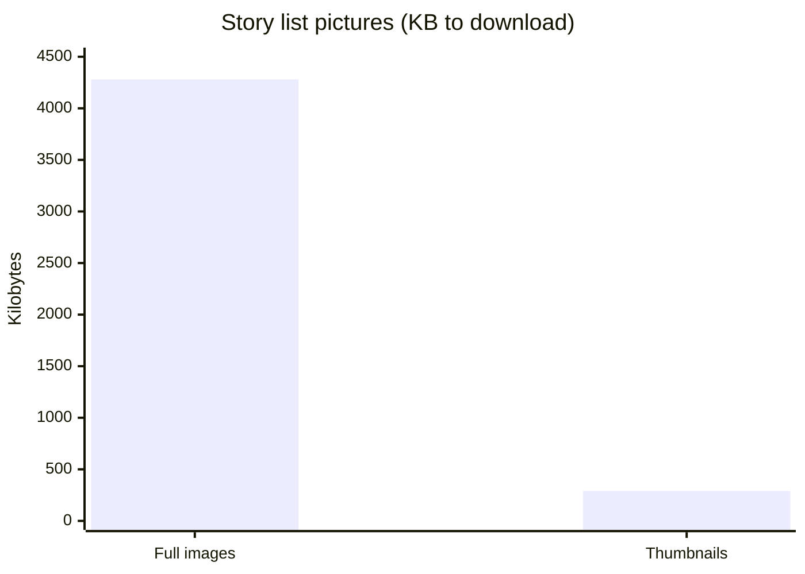

- Local saves wait until you pause typing (0.4 s), then write once — and always flush when the app is hidden or closed.
- Story pictures and the statue are cached on the device for a week.
- The floating orb's glow animates opacity only, so it costs almost no battery.

</details>

---

## Sync between phone and laptop

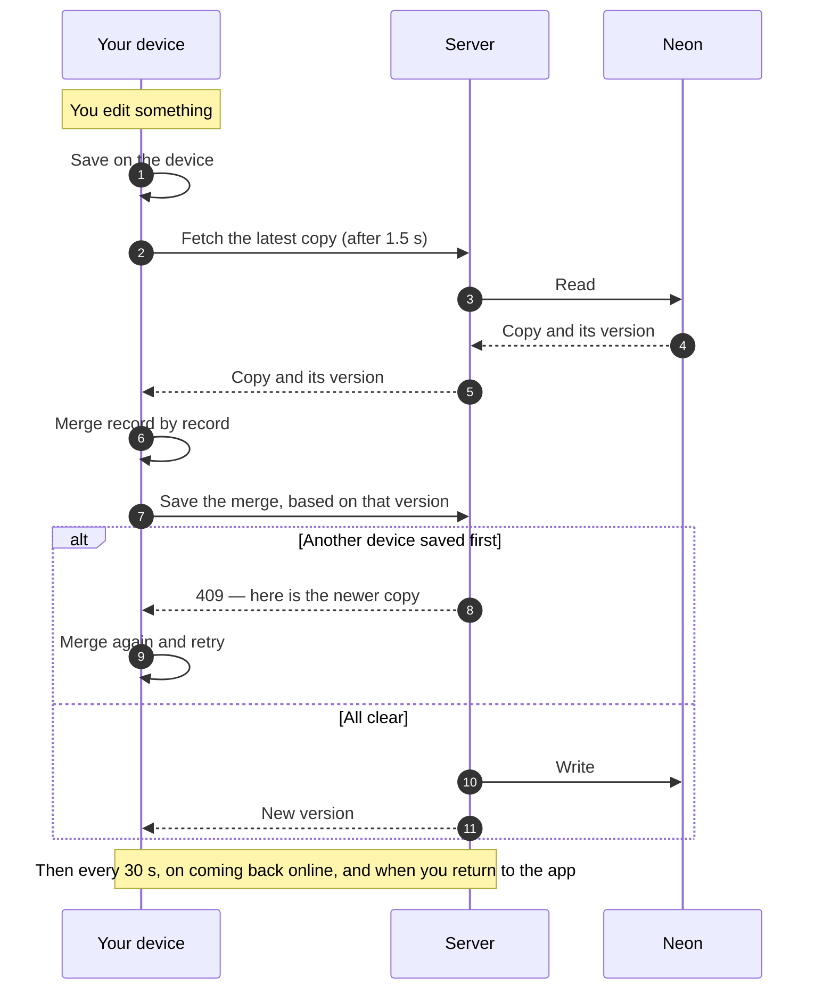

**The merge rules**

| Situation | Result |
| :-- | :-- |
| The same record edited on two devices | The newest edit wins — for that record only |
| Different records edited on two devices | Both are kept |
| A record deleted on one device | The delete wins over any older edit, everywhere |
| A habit ticked on two devices the same day | One tick — each day is its own record |
| *Use this device's data everywhere* (Settings) | Every other device adopts this copy — and keeps its old one as a download, so nothing disappears silently |

---

## Run it

```bash
npm install
npm run dev
```

Open <http://localhost:3000>. On a phone on the same Wi-Fi, open your computer's address (for example `http://192.168.1.20:3000`) and choose **Add to Home Screen**.

| Command | What it does |
| :-- | :-- |
| `npm run dev` | Development server; sync saves to a local `.data/` folder (never committed) |
| `npm run build` | Production build |
| `npm start` | Serve the production build |
| `npm run lint` | ESLint |

---

## Put it online

About ten minutes, all free.

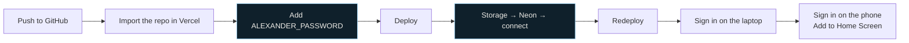

1. Push this project to GitHub.
2. On [vercel.com](https://vercel.com), **Add New → Project** and import the repository. Don't deploy yet.
3. Under **Environment Variables**, add `ALEXANDER_PASSWORD` — a long password only you know. Then **Deploy**.
4. Open **Storage → Create Database → Neon** and connect it to the project. This adds `DATABASE_URL` for you.
5. **Deployments → ⋯ → Redeploy**, so the database setting takes effect.
6. Open your site on the laptop and sign in — your data uploads. Open the **same address** on the phone, sign in, and add it to the home screen.

> [!IMPORTANT]
> Online, sync is refused until `ALEXANDER_PASSWORD` is set, so your data is never exposed without a password. Settings → *Sync across devices* always shows the current state.

> [!TIP]
> **Phone and laptop show different data?** Open Alexander on the device whose data you want to keep → Settings → *Sync across devices* → **Use this device's data everywhere**.

---

## Privacy

Two locks, one on the website and one on each device.

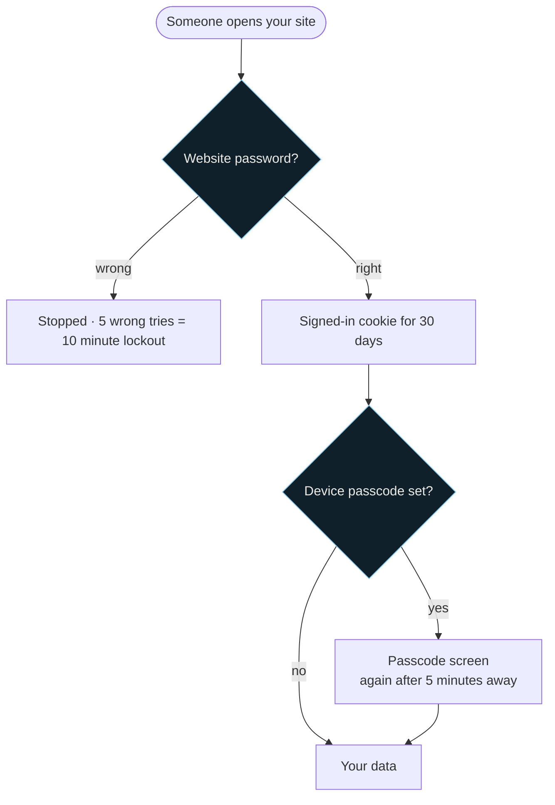

- **Website password** — `ALEXANDER_PASSWORD` in your host's environment (or `.env.local`). Every page and every sync request is checked on the server first. The old spelling `ALEXENDER_PASSWORD` still works.
- **Passcode** — set in Settings → Privacy or during setup. Stored only as a salted hash.
- **Backups** — Settings → *Your data* exports everything, photos included, as one file; import restores it on every device.
- The story pictures and the statue are public-domain images and load without the password, so they can be cached.

---

## Project layout

```text
src/
├─ app/                    one folder per section
│  ├─ page.tsx             Today
│  ├─ habits/  timer/  calendar/  mission/  goals/  plans/  ideas/
│  ├─ journal/  books/  videos/  podcasts/  stories/  bucket/  dont/
│  ├─ life/  settings/  login/
│  └─ api/                 sync · images · auth · oembed
├─ components/             AppShell (bars, orb), dialogs, charts, lists, timer watcher
├─ lib/
│  ├─ store.ts             all data and actions (Zustand + IndexedDB)
│  ├─ sync.ts · merge.ts   keeping devices in step
│  ├─ timer.ts · life.ts   the maths behind Timer and Life
│  ├─ stories.ts           the 56 stories and their sources
│  └─ server/              Neon storage and the sync guard
└─ proxy.ts                the website password gate
public/
├─ alexander.webp          the statue
└─ stories/                story pictures (+ thumbs/ for the list)
```

<sub>Internal storage names still say <code>alexender</code>, so data and backups from earlier versions keep working.</sub>

---

## Credits

- **The statue** — the marble head of Alexander in the British Museum, cut from its background.
- **Story pictures** — ancient mosaics, coins, statues, period portraits and photographs from Wikimedia Commons, credited in the app beside each story.
- **Book covers** — Open Library. **Video details** — YouTube's public oEmbed.
- **Life expectancy** — UN World Population Prospects estimates, by country.

<br/>

<div align="center">

*Alexander changed the world before he was thirty-three.*<br/>
*Count your weeks. Spend them well.*

<br/>

<sub>Built for one person · No ads · No tracking · No AI</sub>

</div>
